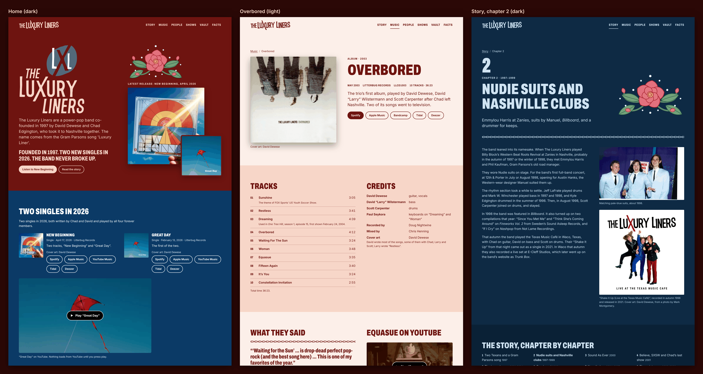

# Design sample A: "Stitched"

Static HTML and CSS for Direction A in `plan/00-master-plan.md` §6: the band's suits, embroidered. The sample has three pages:

| Page | File | Era pair |
|---|---|---|
| Home: the 2026 singles first (LL-26), then an era collage (LL-32) and the four forever members | `index.html` | oxblood / blush, with a deep-sky band for the 2026 singles |
| The *Overbored* release page | `overbored.html` | oxblood / blush (2001–2007, the trio years) |
| Story, chapter 2: "Nudie suits and Nashville clubs" | `story-nudie-suits.html` | navy / powder (1997–2000, the powder-blue-suit years) |

**Serve it over HTTP** (for example, `python3 -m http.server` in this folder). The engraved plates are CSS masks, and Chromium won't apply a mask from a `file://` URL. The logos are drawn with `<use>` from `logos/web/`, which also needs HTTP.



## Rationale

- **One bold embroidered element.** It's a Nudie-style rose spray in satin stitch (`tools/make_rose.py` → `tools/partials/rose-spray.svg`). Every petal and leaf is filled with a pattern of fine thread lines. The pattern turns with each shape, the way satin stitch changes direction from petal to petal, and rhinestones sit around the spray. It appears once per page: in the home hero above the latest release, and as the opener of the Nudie-suit chapter. The *Overbored* page doesn't use it, because that's the trio's plain-clothes era. It isn't a patch and has no dashed borders.
- **The chain stitch** is the only other motif. It's a row of linked loops, like the piping on a Western shirt, used as a rule at most three times per page (plan §6, risk mitigation).
- **Engraved portraits, made large.** `tools/build_images.py` turns two sharp, real band photos into line engravings: the 2002 photo of all four (home) and the 2003 *Overbored* promo by Amy Wilstermann (release page). Each engraving is rendered at 2000 px for a plate that shows at most about 1040 CSS px wide, with wide line spacing. That keeps faces drawn in 20 or more lines, never a small, mushy engraving. Each plate is an **alpha mask** painted in the theme ink, so the theme switch recolours it at once. The dark theme draws the highlights and the light theme draws the shadows, so both read as a positive portrait (the daviddewese.com P32 idea, re-implemented with numpy and Pillow; no AI drawing). Archive photos and covers stay in full colour.
- **Home leads with the 2026 singles** (LL-26): "Latest release: New Beginning, April 2026", both covers, the LL-6 one-liner verbatim, and the status line. The singles band below carries the dates, links and a click-to-load "Great Day" video.
- **Era collage** (LL-32): it favours the best-dressed early photos (pale-blue suits backstage and at the Hard Rock Cafe in 1998, the c. 2000 white-studio sessions) and also shows the trio in 2003. The forever-members photo appears as the large engraved plate under "The four forever members". Its caption is exact (P23). Because Chad's card says 1997–2001 and sits beside a 2002 photo, a context line says he left Nashville in March 2001 and plays on both 2026 singles. David's and Chad's role lines say "writes songs" (people data: `songs`).
- **Overbored**: the lede says "The trio's first album, played by …". It never says "ten songs by the trio", because Chad co-wrote some of them. The songwriting line reads "David wrote most of the songs, some of them with Chad, Larry and Scott; Larry wrote 'Restless'". Per-track writers aren't listed (one credit is withheld). The page has positive press excerpts only, dated, as printed; the TV placements; credits; and the cover in full colour with its credit and the P40 rights line.
- **Story chapter 2** uses the copy from `content/story/02-nudie-suits.md` unchanged. **No quotation about Manuel or the Nudie suits is used**: David's account is from 2001, and the sample doesn't risk dating it 1998 or setting it over the pale-suit photos. The pale-blue photo has a plain caption and makes no claim about who made the suits.
- **Cover-rights line** ("Cover art: all rights reserved by the rights holders.") appears in the footer only on pages that show a cover. All three do: the home page shows the 2026 singles, the release page shows *Overbored*, and the story page shows the *Shake It Up (Live)* artwork.
- **Nothing outside the band** (LL-7): names, roles, years and band-era photos only. No contact address is printed; the footer links to `/contact/`. There's no newsletter (LL-40), no downloads or MP3s (LL-27), no talent-show story and no demo or bonus-disc mention (LL-13), and no logo designer credit (LL-39). The colophon says only that the logos date from 1999–2002.

## Palette

Each era is a **pair**: light-on-dark in the dark theme (the default, P35) and dark-on-light in the light theme. Ratios are WCAG 2.x.

| Era | Dark theme (ground / ink) | Ratio | Light theme (ground / ink) | Ratio |
|---|---|---|---|---|
| 2001–2007 and anchor: oxblood / blush | `#6E1410` / `#F7D6C8` (surface `#5A0F0C`, 10.21) | 8.70 | `#FCEFE9` / `#6E1410` (surface `#F7D6C8`, 8.70) | 10.54 |
| 1997–2000: navy / powder | `#0E2A44` / `#CFE3F2` (surface `#0A2136`, 12.40) | 11.11 | `#EAF3FA` / `#0E2A44` (surface `#CFE3F2`, 11.11) | 13.05 |
| 2008–2026: deep sky / white | `#0B3A66` / `#FFFFFF` (surface `#082E52`, 13.79) | 11.59 | `#FFFFFF` / `#0B3A66` (surface `#E3EEF8`, 9.86) | 11.59 |

The secondary inks are `#EFC3B2` on oxblood (7.41), `#B9D4EA` on navy (9.54) and `#E2ECF6` on deep sky (9.70). The thread colours (rose `#E05A73`, leaf `#5F9A64`, gold `#E8B64C`, rhinestone white) are decorative only and never carry text. Focus rings are 3 px in the ink colour, and links are underlined.

## Type

- **Archivo** (OFL), cut to a static subset `fonts/archivo-display.woff2` (23 KB). It keeps the weight range 600–900 and the width range 62–100%, Latin only. Titles use condensed ExtraBold capitals, an echo of the band's crossed-X wordmark.
- **Inter** (OFL), roman and italic (26 KB and 28 KB), for body text. It's the same files as daviddewese.com.
- The three font files total 78 KB, all self-hosted. Licences are in `fonts/`.

## Logos

The marks are cut from `assets/derived/logos/*.svg` by `tools/extract_logos.py`. Every path's `d`, fill rule and transform is copied byte for byte; only the viewBox is tightened. Nothing is redrawn.

- `logos/*.svg` keep the **original colours** (near-black `#231F20`, red `#EB2D2E` / `#ED1C24`, slate `#536979`, white).
- `logos/web/*.svg` are the copies the pages draw. **Recolour, noted here:** only the near-black ink is mapped to `currentColor`, so the marks take the theme ink (blush on oxblood, oxblood on blush, powder on navy). The red, slate and white are unchanged.
- Uses: the condensed one-line wordmark in the header, the stacked wordmark with the slate LXL oval as the home `h1`, the black "L" roundel in the footer, and the red roundel with the spaced wordmark as the favicon.
- The *logos.ai* sheet clips two shapes very slightly; the cut-outs drop those clip paths, with no visible difference at web sizes.

## Behaviour

- **Theme switch** (footer): a toggle button labelled "Light theme". Only `aria-pressed` changes; the label stays the same. The choice is stored in `localStorage` and applied in `<head>` by `js/theme.js` before first paint.
- **YouTube**: a click-to-load facade. Nothing is requested from YouTube until you press play; then an iframe loads from `youtube-nocookie.com`. Without JavaScript, the facade is a plain link to the video. The videos are "Great Day" (the official art track) on the home page and "Equasue" from the band's YouTube channel on the release page. The Equasue poster is that video's own thumbnail, saved locally.
- **Accessibility**: there's a skip link, landmarks, one `h1` per page, real alt text, and decorative SVG marked `aria-hidden`. The pages have no inline styles. Under reduced motion there's no motion; otherwise the only movement is a 4 px lift on collage photos on hover.

## Checks and how to rerun them

```sh
python3 tools/extract_logos.py   # logos/ and logos/web/ from the logo sheets
python3 tools/make_rose.py       # the embroidered rose spray partial
python3 tools/build_images.py    # resized photos and covers, engraved plates
python3 tools/build_pages.py     # the three HTML pages
python3 check_sample.py          # banned content (add --self-test to prove each rule fires)
node ../../../content/check-content.mjs --dist-only .   # the repository's content checker
node tools/test_sample.mjs --shots && python3 tools/shrink_overview.py
```

`tools/test_sample.mjs` serves the folder over local HTTP, blocks every off-site request, and runs these checks on all three pages:

- axe-core in both themes: 0 violations
- no off-site request on load
- no inline styles
- all images and fonts load
- no horizontal scroll at 375 and 320 px in both themes
- nav links wrap without overlapping or overflowing
- the theme switch changes state, not its label
- the video facade loads nothing until clicked, then loads `youtube-nocookie.com` only

The last run (2026-11-06) passed every check. `check_sample.py` and `content/check-content.mjs` report 0 errors.

## Screenshots

- `screenshots/overview.png`: the three pages side by side at desktop width (1280 CSS px), deviceScaleFactor 2. Each column shows the first 2000 CSS px of its page (home dark, *Overbored* light, story dark). The PNG is reduced to a 256-colour palette to keep this folder under about 8 MB.
- Per page (deviceScaleFactor 1, full length, JPEG): `{home,overbored,story}-desktop-dark.jpg`, `-desktop-light.jpg`, `-375-dark.jpg` and `-320-light.jpg`.

## Sources

- Copy: `content/home.md`, `content/story/02-nudie-suits.md`, `content/story/06-overbored.md`, `content/people.json` and `content/press.json`.
- Releases: `data/releases.json`.
- Photos and credits: `data/assets.json`. Credits are shown only where `credit_status` is `named-credit-confirmed`.
- Nav links to pages that aren't in the sample (People, Shows, Vault, Facts, Contact, the other chapters) point at their planned paths.
