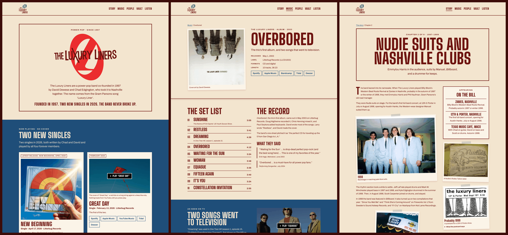

# Design sample B: "Tonight, No Cover"

Direction B from `plan/00-master-plan.md` §6: every page is a gig poster. Big stacked wood-type capitals, two flat inks on a paper ground, and the band's photos and flyers taped up like a flyer wall. The name comes from the band's own letterpress-style poster ("The Luxury Liners / Texas Pop / Tonight No Cover"), which hangs on the home page wall.

Static HTML and CSS, no build step needed to view: open `index.html` in a browser.



## The three pages

| Page | File | What it shows |
|---|---|---|
| Home | `index.html` | The bill: the condensed wordmark over the red roundel, the LL-6 one-liner verbatim, the status line. Then the **2026 singles first** (LL-26): *New Beginning* as the pinned latest release and *Great Day* with a click-to-load video, both with listen links. The LL-17 wording verbatim. The **era collage** (LL-32) as a flyer wall: 1998 pale-blue suits and the Hard Rock Cafe, the c. 2000 white-studio sessions, the 2002 photo of the four forever members (P23 caption, exact), 2003, and three real flyers with transcriptions. The four forever members set as a bill, three ticket-stub doors, the disambiguation line. |
| Release | `overbored.html` | *Overbored* (2003): cover in full colour, public date (P6), label and catalogue number, listen links, the track list as a set list with the two TV placements, the record's story and press excerpts as printed, the *One Tree Hill* and FOX Sports placements, the "Equasue" video (band's channel) behind a facade, credits, the 2003 trio photo. |
| Story chapter | `story-nudie-suits.html` | Chapter 2, "Nudie suits and Nashville clubs" (1997–1999), using the approved copy in `content/story/02-nudie-suits.md` word for word, with an "On the bill" poster sidebar of the three venues in the chapter, 1998 photos, the Nudie's label, the 12th & Porter postcard, and the live "Shake It Up" single. |

Navigation links that point at pages outside the sample (People, Vault, Listen, footer pages) go to placeholder anchors.

## Design system

- **Inks (light, "paper", the default):** paper `#F4E6D0` ground, oxblood `#6E1410` ink (9.64:1), powder-blue `#1F4E79` links (7.04:1), and the same blue as a flat block with paper text. A lighter card `#FBF4E8` is the fresh flyer pasted on the paper.
- **Dark, "after hours":** oxblood ground, paper ink (9.64:1), powder `#CFE3F2` links (8.99:1), navy `#0E2A44` blocks. The light link blue is never used on oxblood. All pairs pass 7:1; `python3 tools/contrast.py` prints them.
- **Theme:** light by default as the plan says; the footer button ("After hours") switches and remembers the choice in `localStorage` (wrapped in try/catch). `?theme=dark` forces a theme for screenshots and review. The toggle stays hidden if JavaScript is off.
- **Type:** Big Shoulders Display 800 (OFL) for poster headings, Archivo variable (OFL) for text at 17–18 px and up. Self-hosted WOFF2, Latin subset, 89 KB in three files; licences in `fonts/`.
- **Motif:** flat flyer cards, slightly tilted, held by a flat strip of tape; a printer's double rule; ticket-stub doors. No grain, no distressing, no fake letterpress texture (plan rule 4). The only motion is a card straightening on hover, and only when reduced motion is not requested.
- **Logos:** the band's real marks, cut from `assets/derived/logos/*.svg` by `tools/extract_logos.py`. Every path (`d`, fill rule, transform) is copied byte for byte; only a tight viewBox is added. Each mark is also written in two ink variants (`--oxblood`, `--paper`) in which only the sheet's near-black fill value is swapped for the theme ink; red, slate and white stay as drawn. The pages load these with ``. Marks used: the stacked "THE LUXURY LINERS" with the slate LXL oval (masthead), the condensed wordmark over the red roundel (home bill), the red roundel with the spaced wordmark (footer). No designer credit (LL-39); the colophon says the logos date from 1999–2002.
- **Photos and covers:** real files from `assets/`, resized to WebP by `tools/build_images.py` with no filters. The only edit is trimming plain black scanner margins off the "Texas Pop" poster scan. Credits follow `data/assets.json`: only `named-credit-confirmed` photographers are shown (Mark Montgomery, Amy Wilstermann); P17 photos carry no credit line. People are not named in captions where `assets.json` says positions are unconfirmed. Covers carry the P40 rights line.
- **Flyers** always have a transcription in a `<details>` under the image. Flyers that `assets.json` marks archive-only (third-party photos or film stills) are not used.

## Privacy and content rules built in

- Band roles, years and band-era photos only (LL-7). Nothing about members' lives outside the band, no states per member, no founding town, no college, no old addresses, phone numbers, family page or band email. The contact address appears nowhere in this folder.
- No talent-show story; nothing about the history of the "Great Day" recording (LL-13). No MP3s or downloads (LL-27). No newsletter (LL-40). LL-6 and LL-17 wording verbatim. "Shake It Up" is presented as the band's own song.
- No sourcing notes in the copy. Overbored's per-track writers are not listed (the chapter copy's summary is used instead).
- YouTube: nothing loads from YouTube until a visitor presses play; the facade then inserts a `youtube-nocookie.com` iframe. The facade stills are the band's own cover art and a 2003 band photo, not YouTube thumbnails.

## Checks

| Command | What it proves | Result |
|---|---|---|
| `python3 check_sample.py` | Banned content in the built pages (talent show, demo/bonus disc, downloads, newsletter, designer credit, sourcing notes, privacy terms, "broke up"/"reunion"/"former", unverified items, phone numbers, any email address); required wording (LL-6, LL-17, the P23 caption, the status line); no third-party scripts or styles; no static iframe; contact address absent from every file; folder under 8 MB | all clear, 7.2 MB |
| `python3 check_sample.py --self-test` | Every banned pattern fires on a sample string | pass |
| `node content/check-content.mjs --dist-only design/samples/b-tonight-no-cover` (from the repo root) | The repository's own content rules on these pages | 0 errors, 0 warnings |
| `node tools/test_sample.mjs` | axe-core (WCAG 2.0/2.1/2.2 A and AA plus best practice) on every page in both themes at 1440, 375 and 320 px: 0 violations in all 18 runs; no horizontal scroll at 375 and 320; no network request before interaction; the skip link is the first tab stop and lands on `<main>`; the toggle flips the theme and `aria-pressed`; the facade inserts a `youtube-nocookie.com` iframe. Also writes the per-page screenshots | all checks passed |
| `python3 tools/contrast.py` | Every colour pair in both themes | all pass (7.04:1 lowest) |

The Node scripts borrow `playwright-core` and `axe-core` from `site/node_modules` (nothing is installed here) and use the preinstalled Chromium at `/opt/pw-browsers/chromium-1243/chrome-linux64/chrome`.

## Screenshots

- `screenshots/overview.png`: the three pages side by side at 1440 px, deviceScaleFactor 2, top 2000 CSS px of each, light theme (`node tools/make_overview.mjs`).
- Per page, full length, deviceScaleFactor 1: `home-`, `overbored-`, `story-` × `desktop-light`, `desktop-dark`, `375-dark`. The 320 px runs are tested but not kept, to stay inside the size budget.
- PNGs are reduced to 256-colour palettes by `tools/shrink_shots.py`.

## Rebuilding

```sh
python3 tools/build_images.py    # img/ from assets/
python3 tools/extract_logos.py   # logos/ from assets/derived/logos/
python3 tools/build_pages.py     # *.html from tools/src/ (shared head, masthead, footer; image sizes)
node tools/test_sample.mjs && python3 tools/shrink_shots.py
node tools/make_overview.mjs
python3 check_sample.py
```

Edit page copy in `tools/src/*.html`, not in the built pages.

## Known limits

- The flyer wall is a CSS multi-column layout, so it reads top to bottom by column (chronological in the source order), not across rows.
- The masthead logo is small (76 px wide); at that size the slate LXL oval reads as a badge rather than as letters.
- The Texas Pop poster, the postcard and the Exit/In flyer exist only as 330–350 px web copies, so they stay small on the wall.
