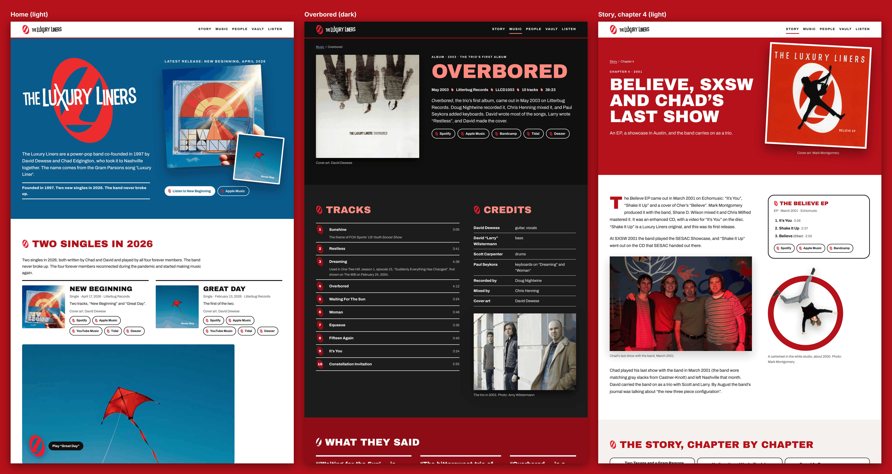

# Design sample C: "Roundel"

Static HTML and CSS for Direction C in `plan/00-master-plan.md` §6. It's the *Believe*-era red and white, built around the band's red "L" roundel, with the 2026 sky blue as the "now" layer. The sample has three pages:

| Page | File | Ground |
|---|---|---|
| Home. The 2026 singles come first (LL-26), then an era collage that includes the forever-members photo (LL-32), then the four forever members, the three doors and the disambiguation line. | `index.html` | sky-blue hero, white, then a *Believe*-red collage band |
| The *Overbored* release page | `overbored.html` | white and warm surface, with a red press band |
| Story, chapter 4: "Believe, SXSW and Chad's last show" | `story-believe.html` | full *Believe*-red chapter head |

**Serve it over HTTP**, for example with `python3 -m http.server` in this folder. The marks are drawn with `<use href="logos/sprite.svg#…">`, and Chromium won't follow that from `file://`.



## Rationale

- **The roundel is the recurring device.** It's the red "L" roundel from the logo masters. It marks every section head and person, it's the icon on every listen pill, and it's the favicon. The YouTube play button is the roundel too, and it spins once when a player starts. The track and chapter numbers sit in small red ovals tilted at the roundel's angle. Those ovals are plain CSS shapes, not the logo. On red grounds the same mark appears in white: the black roundel is drawn in `currentColor`, which echoes the white ring on the *Believe* cover.
- **The *Believe* cover is the model.** That cover shows a leaping silhouette over a white ring on red, and the home collage and the chapter aside repeat that idea with a real photo. The c. 2000 white-studio cartwheel (Photo: Mark Montgomery) is cut out of its backdrop and leaps out of a white ring (a red ring on the light chapter page). The cut-out is masked from the real photo by `tools/build_images.py`. Nothing is painted or redrawn: the white cyclorama is modelled as a smooth colour surface, and pixels that match it become transparent. Only one cut-out is used, because it's the only white-studio frame that is cleanly separable and has a confirmed credit. The other studio frames stay as framed photos.
- **The home page leads with the 2026 singles** (LL-26). The hero is a sky-blue band. It holds the full mark (the condensed crossed-X wordmark over the red roundel) as the `h1`, the LL-6 one-liner verbatim and the status line. Beside them sit "Latest release: New Beginning, April 2026" with both covers in full colour and the listen links. Next, "Two singles in 2026" gives the dates, the label, the cover credits, every DSP link, the LL-17 wording verbatim, and a click-to-load "Great Day" video.
- **The era collage** (LL-32) sits on *Believe* red with white-framed snapshots. It shows the pale-blue suits backstage in 1998, the pale-blue trio, two white-studio frames from about 2000 and the cartwheel cut-out. It also shows the forever-members photo with its exact caption ("David Wilstermann, Chad Edgington, David Dewese and Scott Carpenter in 2002") and a context line: Chad left Nashville in March 2001, and all four play on the 2026 singles. The 2003 trio photo by Amy Wilstermann completes the set. Captions name only what the asset records support. Where positions are unconfirmed, nobody is named.
- ***Overbored*** uses the Story ch. 6 copy unchanged as its lede, so it never credits every song to the trio. The page lists the tracks with the two TV placements, the credits from `data/releases.json` (Paul Seykora on tracks 3 and 6) and three positive press quotes, dated and exactly as printed (*Metroland*, *Nashville Rage*, *Performing Songwriter*). The one-sheet line is included. "Equasue" comes from the band's own YouTube channel, behind a facade with no thumbnail: a white ring and the roundel on black. The pager links the neighbouring releases.
- **Story ch. 4** uses `content/story/04-believe.md` unchanged. The red chapter head carries the *Believe* cover (Cover art: Mark Montgomery, LL-23). The text column shows the photo from Chad's last show, captioned "Chad's last show with the band, March 2001." with no names, because their order is unconfirmed. The aside is an EP card with the tracklist, "Believe" credited to Cher, and listen links.
- **The cover-rights line** ("Cover art: all rights reserved by the rights holders.") is in the footer, and every page shows a cover.
- **Nothing outside the band** (LL-7): only names, roles, years and band-era photos appear. No contact address is printed; the footer links to `/contact/`. There's no newsletter (LL-40), no MP3s or downloads (LL-27), no talent-show story and no demo or bonus-disc mention (LL-13), and no logo designer credit (LL-39). The colophon says only that the logos date from 1999–2002. No page links anywhere that lists "Great Day" as a demo.

## Palette

Light is the default (plan §6, Direction C). A stored choice wins, then the reader's system setting. Ratios are WCAG 2.x.

| Token | Light | Ratio | Dark | Ratio |
|---|---|---|---|---|
| ground / ink | `#FFFFFF` / `#111111` | 18.88 | `#111111` / `#FFFFFF` | 18.88 |
| muted text | `#4D4D4D` on white / on surface `#F5F2EE` | 8.45 / 7.57 | `#C9C9C9` on `#111` / on `#1C1C1C` | 11.40 / 10.29 |
| headings (large only) | *Believe* red `#B5121B` on white / surface | 6.85 / 6.14 | `#FF8A80` on `#111` / `#1C1C1C` | 8.27 / 7.47 |
| red for small text | `#9A0E16` | 8.58 | `#FF8A80` | 8.27 |
| links (2026 sky) | `#0A5A8C` on white / surface | 7.36 / 6.59 | `#7CC4F2` on `#111` / `#1C1C1C` | 9.92 / 8.96 |
| red band, white ink | `#B5121B` | 6.85 | `#8F0E15` | 9.37 |
| sky band, white ink | `#0A5A8C` | 7.36 | `#0A3E62` | 11.18 |
| footer | `#111111`, white links, `#D9D9D9` notes | 18.88 / 13.38 | `#000000` | 21 / 14.88 |

The light-theme red and sky are never used on the dark ground, and they fail there (2.76 and 2.57). The logo's own red (`#ED1C24` / `#EB2D2E`) is decorative only and never carries text. Focus rings are 3 px in the link colour, or white on filled bands and in the footer. Links are underlined.

## Type

- **Archivo Black** (OFL, 19 KB) for titles, section heads, names, quotes and the doors, in capitals.
- **Archivo** variable (OFL, weights 100–900; roman 35 KB, italic 39 KB) for everything else.
- All three files are self-hosted Latin subsets from Fontsource, 92 KB in total. Licences are in `fonts/`.

## Logos

`tools/extract_logos.py` is adapted from sample A. It cuts the marks out of `assets/derived/logos/*.svg` and copies every path's `d`, fill rule and transform byte for byte; only the viewBox is tightened. Nothing is redrawn.

- `logos/*.svg` keep the original colours. `logos/web/*.svg` map only the near-black ink to `currentColor`.
- `logos/sprite.svg` holds the same paths as `<symbol>`s, which the pages use. The sprite is used for: the red roundel (markers, pills, play button, favicon); the black roundel in `currentColor` (white on red, in the footer); the condensed crossed-X wordmark (header); and the condensed wordmark over the red roundel (home `h1`).
- The paths live in the sprite, not inline in the HTML. That keeps the raw coordinates out of the pages, where they would trip the repository checker's phone-number rule.

## Behaviour

- **Theme switch** (footer): a toggle button labelled "Dark theme". Only `aria-pressed` changes; the label stays the same. The choice is stored in `localStorage` and applied in `<head>` by `js/theme.js` before first paint.
- **YouTube**: a click-to-load facade. Nothing is requested from YouTube until you press play. Then the roundel spins once and an iframe from `youtube-nocookie.com` replaces the facade. Without JavaScript, the facade is a plain link to the video. The "Great Day" poster is a crop of the cover.
- **Motion**: the cut-out jumps once when it scrolls into view and lifts a little on hover, and the play roundel spins. All of this is off under `prefers-reduced-motion`.
- **Accessibility**: there's a skip link, landmarks, one `h1` per page and real alt text. Decorative SVG is `aria-hidden`. The pages have no inline styles, and touch targets are at least 40–44 px.

## Checks and how to rerun them

```sh
python3 tools/extract_logos.py   # logos/ and logos/web/ from the logo sheets
python3 tools/build_images.py    # resized photos and covers, the cartwheel cut-out
python3 tools/build_pages.py     # logos/sprite.svg and the three HTML pages
python3 check_sample.py          # banned content (add --self-test: 19 probes)
node ../../../content/check-content.mjs --dist-only .   # the repository's content checker
node tools/test_sample.mjs --shots && python3 tools/shrink_overview.py
```

`check_sample.py` is adapted from sample A's checker and adds these rules:

- the contact address or `mailto:` never appears (LL-31)
- "Believe" always comes with Cher (P27), and "Shake It Up" is never called a cover
- no "(confirm)" notes in captions
- photo credits are limited to the confirmed ones (Mark Montgomery, Amy Wilstermann)
- each page has its required strings, such as LL-6, LL-17, the P23 caption and the latest-release label

`tools/test_sample.mjs` serves the folder over local HTTP and blocks every off-site request. It runs these checks on all three pages:

- axe-core in both themes: 0 violations
- no off-site request on load
- no inline styles
- every image and font loads
- no horizontal scroll at 375 and 320 px in both themes
- nav links wrap without overlapping
- the theme switch changes state, not its label
- the video facade loads nothing until clicked, then loads `youtube-nocookie.com` only

The last run (2026-11-06) passed every check, 57 in all. `check_sample.py` and `content/check-content.mjs` both report 0 errors.

## Screenshots

- `screenshots/overview.png` shows the three pages side by side at desktop width (1280 CSS px), deviceScaleFactor 2: home (light), *Overbored* (dark) and the story chapter (light). Each column is the first 2000 CSS px of its page. The PNG is reduced to a 256-colour palette to keep the folder under about 8 MB.
- Per page, at deviceScaleFactor 1, full length, as JPEG: `{home,overbored,story}-desktop-light.jpg`, `-desktop-dark.jpg`, `-375-dark.jpg` and `-320-light.jpg`.

## Sources

- **Copy:** `content/home.md`, `content/story/04-believe.md`, `content/story/06-overbored.md`, `content/people.json` and `content/press.json`.
- **Releases and links:** `data/releases.json`.
- **Photos and credits:** `data/assets.json`. Credits are shown only where `credit_status` is `named-credit-confirmed`.
- **Video:** "Great Day" is the official art track on the Topic channel. "Equasue" is from the band's own channel, @theluxuryliners.
- **Nav links:** links to pages outside the sample point at their planned paths.
